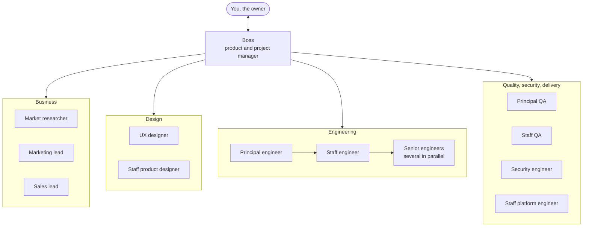
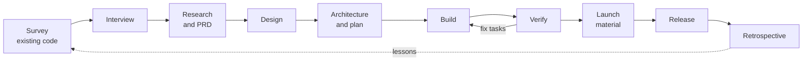
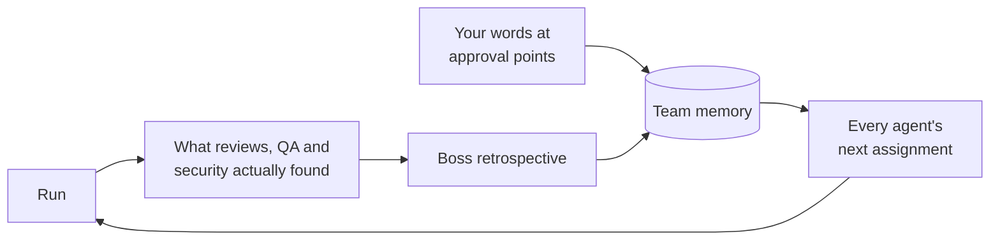

<div align="center">

# Agent Harness

**A software company of AI agents.**

A boss that researches, decides and checks. Designers who study real products before drawing anything.<br>
Engineers who map a codebase before touching it. QA, security and platform who sign off on the whole product.


</div>

```bash
harness run "A booking site for an independent yoga studio"
```

One command takes a request from an interview with you to a reviewed, tested, secured and deployable product. It runs on the `codex` and `claude` command-line tools with your own subscriptions, everything at high effort.

---

## Contents

- [Why this exists](#why-this-exists)
- [The team](#the-team)
- [What a run does](#what-a-run-does)
- [Quick start](#quick-start)
- [Modes](#modes)
- [Commands](#commands)
- [How it gets better](#how-it-gets-better)
- [Skills](#skills)
- [Project layout](#project-layout)
- [Testing the harness](#testing-the-harness)
- [Cost and limits](#cost-and-limits)

---

## Why this exists

Most products built by AI agents look the same and break in the same places. This harness is built around four ideas that push against that.

| | |
|---|---|
| **Design from evidence** | Before anything is drawn, the designers capture and measure 12 to 20 real, live products that real customers use. Every screen then passes a slop check that knows the tells of generic AI-made design. |
| **Understand before changing** | On an existing codebase, the engineers first build a knowledge base: the code divided into areas, each surveyed in depth, plus how it is deployed, tested and secured. Everyone works from that map. |
| **A boss who decides** | One agent owns the requirements, reviews every phase, accepts or rejects the product against them, and makes the release call. Work that is not good enough goes back to the role that can fix it. |
| **A team that learns** | After every run, a retrospective turns what reviews, QA and security found into lessons each role reads before its next job. Your feedback is kept word for word. |

---

## The team



| Role | Engine | What it does |
|---|---|---|
| **Boss** | Codex or Claude Fable | Interviews you, writes the requirements, reviews every phase, accepts or rejects the product, makes the go / no-go call, runs the retrospective |
| **Market researcher, marketing lead, sales lead** | Codex or Claude Fable | Market and competitor research with sources, positioning, launch plan, sales kit |
| **UX designer** | Claude Opus | Studies real products in the industry, then flows, wireframes, content and the screen specification |
| **Staff product designer** | Claude Opus | Three distinct coded directions, the design system, tokens, prototype, and design QA of what was built |
| **Principal engineer** | Claude Opus | Architecture, scalability and technical decisions; leads the survey of an existing codebase |
| **Staff engineer** | Claude Opus | Surveys codebase areas, plans parallel work, reviews every task before it merges, integrates the build |
| **Senior engineers** | Claude Opus | Build each task test-first, each in its own git worktree |
| **Principal QA and staff QA** | Claude Opus | Test strategy and gates; tests at every level, real-browser testing, verification of the whole product |
| **Security engineer** | Claude Opus | Threat model, code and deployment review, research into what is being exploited right now |
| **Staff platform engineer** | Claude Opus | Chooses hosting, builds CI/CD and infrastructure, deploys once go-live is approved |

Run `harness team` to see every role with its skills.

---

## What a run does



| # | Phase | What happens |
|---|---|---|
| 1 | **Survey** | Only when the folder already has code. The principal engineer divides the codebase into areas, staff engineers survey them in parallel, platform, QA and security map deployment, testing and security, and the boss is briefed. Later runs refresh only what changed. |
| 2 | **Interview** | The boss researches the industry, then asks you its questions in the terminal. |
| 3 | **Research and PRD** | Market research, the requirements, a challenge of those requirements by engineering and UX, positioning. |
| 4 | **Design** | Study of real sites, UX and wireframes, three coded directions, your choice, design system and prototype, screen specification. |
| 5 | **Architecture and plan** | Architecture, test strategy, threat model, deployment plan, and a task graph for parallel work. |
| 6 | **Build** | Tasks run in parallel worktrees. Each is code-reviewed before it merges. |
| 7 | **Verify** | QA, security and design QA examine the whole product. The boss accepts it or sends fix tasks back, and it is verified again. |
| 8 | **Launch material** | Launch plan and sales kit. |
| 9 | **Release** | Delivery pipeline, deployment security review, go / no-go, your approval, deploy, live smoke test. |
| 10 | **Retrospective** | The boss turns what happened into lessons the team keeps. |

The work happens on a branch named `harness/<run-id>`, so your own branch is never touched. The team's documents are written to `docs/`, or to `docs/team/` when the product already has a `docs` folder.

---

## Quick start

**You need:** Node 20 or newer, git, the [`claude`](https://claude.com/claude-code) CLI logged in, and the `codex` CLI logged in. Codex is optional: without it the boss runs on Claude Fable.

```bash
git clone https://github.com/Tanmoy037/agent-harness.git
cd agent-harness

# browser tooling for the designers and QA (uses the Chrome already installed)
(cd tools && npm install)

# check that everything the team needs is in place
node bin/harness.mjs doctor

# optional: make `harness` available everywhere
npm link
```

Then, from the folder of any product, new or existing:

```bash
harness run "what you want built"
```

The harness asks how the team should work (see [Modes](#modes)), the boss interviews you, and the run begins. Press Ctrl-C at any time; `harness resume` continues from the first unfinished step.

---

## Modes

Nothing about how the team works is fixed. You choose at the start of each run; flags skip the questions and `--defaults` reuses your saved choices.

| Mode | Flag | Choices |
|---|---|---|
| Who is the boss | `--boss` | `codex` · `claude` (Fable) |
| Your approval points | `--approvals` | `design-golive` (default) · `every-phase` · `golive-only` · `autonomous` |
| Agent access to your machine | `--access` | `guarded` (default) · `bypass` · `strict` |
| What is being built | `--type` | `web-app` · `marketing-site` · `mobile-app` · `backend` |
| Codebase survey | `--survey` | `auto` (default) · `always` · `never` |
| Engineers in parallel | `--engineers` | `1` to `8` |
| Business specialists | `--business` | `true` · `false` |

<details>
<summary><b>What the access modes mean</b></summary>

<br>

In every mode, agents cannot read your SSH, cloud or CLI credentials and cannot use `sudo`. Pushing, publishing and deploying stay blocked until go-live is approved, by you or, in `autonomous`, by the boss.

| Mode | Behaviour |
|---|---|
| `guarded` | Claude's automatic permission mode: routine work runs, risky actions are refused |
| `bypass` | No permission checks beyond the rules above. Fastest; an agent mistake can affect anything your account can touch |
| `strict` | File edits plus a fixed list of commands. Safest; agents are blocked more often |

</details>

<details>
<summary><b>What the approval modes mean</b></summary>

<br>

| Mode | You approve |
|---|---|
| `design-golive` | The design direction, and anything that deploys or publishes |
| `every-phase` | The requirements, the design, the architecture and the release |
| `golive-only` | Only what deploys or publishes |
| `autonomous` | Nothing. The boss makes every call, including deploying |

When you give feedback at an approval point, the boss turns it into revision instructions for the right roles, and your words are stored in the team's memory.

</details>

---

## Commands

| Command | What it does |
|---|---|
| `harness run "<request>"` | Start a run in the current folder |
| `harness resume [run-id]` | Continue a paused, interrupted or failed run |
| `harness status` | Phase, steps, time and cost of the latest run |
| `harness survey` | Map an existing codebase into the knowledge base, nothing else |
| `harness ask <role> "<task>"` | Give one task to one team member |
| `harness team` | List roles, engines and skills (`team build` rebuilds role folders) |
| `harness skills list` | Every installed skill and who carries it (`install`, `audit`) |
| `harness memory [scope]` | What the team has learned (`memory forget <id>` retires a lesson) |
| `harness stats` | Quality trend across runs |
| `harness retro [run-id]` | Run the retrospective for a run that did not reach it |
| `harness doctor` | Check the CLIs, logins and tools |

Useful flags: `--project <dir>` to work on another folder, `--from <phase>` and `--until <phase>` to run part of the pipeline, `--quiet` to hide live activity, `--no-interactive` to pause at approval points instead of prompting.

---

## How it gets better



- **Lessons per role, team lessons, your preferences and product facts** are plain JSON-lines files under `memory/`, with product facts under `<product>/.harness/memory/`. They are placed in every agent's assignment.
- **Only two things write lessons:** your own words at an approval point, stored verbatim, and the boss's retrospective, which works from the factual record of the run.
- **A lesson seen again is counted, not duplicated,** so confirmed lessons rise to the top. Wrong ones are retired.
- **The design reference library and direction log** grow with every product, so later products start from more evidence and do not converge on one look.
- **A recurring procedure can become a learned skill** in `skills/learned/`. You are asked first when you are at the terminal.
- **`harness stats`** shows first-pass approval rates, verification rounds and blockers for each run.

Everything the team learns is a file you can read, edit or delete, and it is committed to this repository's history.

---

## Skills

Each role carries its own curated set, visible only to that role's sessions.

| Folder | Count | What it holds |
|---|---|---|
| `skills/vendor/` | 160 | Open-source skills, copied unmodified at a pinned commit, with their licences |
| `skills/custom/` | 31 | Written for this team where no adequate open-source skill existed |
| `skills/learned/` | grows | Written by the team after retrospectives |

<details>
<summary><b>Skills written for this team</b></summary>

<br>

| Area | Skills |
|---|---|
| Design | `reference-site-study` · `design-reference-sources` · `design-direction` · `slop-check` · `design-handoff` · `design-qa-loop` · `design-house-rules` · `wireframe-spec` |
| Engineering | `codebase-survey` · `working-in-existing-code` · `task-breakdown` · `build-vs-buy` · `capacity-and-scalability` · `product-flow-docs` · `implementing-designs` |
| QA | `regression-impact-map` · `quality-gates` · `bug-report` · `browser-testing` |
| Security | `authz-review` · `threat-intel-sweep` |
| Platform | `platform-selection` · `production-readiness` · `release-and-rollback` |
| Boss | `owner-interview` · `acceptance-review` · `go-no-go` · `team-coordination` · `retrospective-lessons` · `risk-register` |
| Business | `evidence-based-research` |

</details>

`team/roles.json` assigns skills to roles; run `harness team build` after editing it. `harness skills audit` scans every skill for patterns worth a human look.

The team handbook (`team/handbook.md`) puts the team's rules above any skill: no sign-ups, no installing by piping a download into a shell, no telemetry, no skipping confirmations.

Third-party skills remain under their own licences (MIT, Apache-2.0, CC BY 4.0 and CC BY-SA 4.0). Sources, commits and licences are listed in [`skills/THIRD_PARTY.md`](skills/THIRD_PARTY.md), with thanks to their authors.

---

## Project layout

```
bin/harness.mjs          entry point
src/                     orchestrator: modes, permissions, runners, phases, memory
team/roles.json          roles, engines and skill assignments
team/prompts/            instructions for each role
team/handbook.md         the rules every role shares
skills/                  vendor, custom, learned
tools/site-study.mjs     captures a page at desktop and phone widths and measures
                         its fonts, colours and spacing
memory/                  what the team has learned (created on first use)
build/                   generated per-role folders (not committed)
```

In a product folder the harness keeps `.harness/` for run state, transcripts, worktrees and product memory. It is excluded from git locally and never enters your product's history.

<details>
<summary><b>Configuration</b></summary>

<br>

Optional settings go in `harness.config.json` at the root:

```json
{
  "options": {
    "stepTimeoutMin": 120,
    "reviewRounds": 2,
    "verifyLoops": 3,
    "maxAreas": 16,
    "surveyRounds": 2
  }
}
```

Models are set in `team/roles.json` under `engines`. The Codex model is left unset so that it follows your own Codex configuration.

</details>

---

## Testing the harness

```bash
npm test
```

runs unit tests and a full pipeline with stand-in agents (`HARNESS_FAKE_AGENTS=1`). No model is called, but git, worktrees, merge conflicts, review loops, approval pauses, resume and memory are exercised for real.

---

## Cost and limits

A full run is many long sessions at high effort. Parallel engineers multiply the rate at which your Claude subscription limit is used. If a limit is hit, the run pauses and `harness resume` continues it later.

On a very large codebase, the survey goes deep where your request lands and gives an overview elsewhere. Run `harness survey` again with a different request to deepen other areas.
